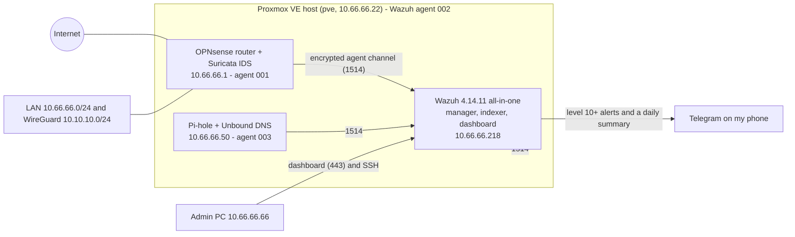

# HomeLab SIEM

I built, tuned and documented a Wazuh SIEM in my home lab over two days (25 and 26 November 2026). It watches my router and IDS, my DNS server, my hypervisor and the SIEM server itself, and it sends anything important to my phone through Telegram. Everything in this repo comes from the real setup: the configs, the custom rules, the scripts, example alerts and before and after screenshots, with secrets and public IP addresses removed.

On the second day the SIEM caught a real event. Suricata flagged a device on my network looking up a domain that ThreatFox lists for malware payload delivery, and I traced it within minutes to the device and the website that caused it. The [incident report](docs/incident-report-threatfox.md) walks through it.

## Results

| Area | Before | After |
|---|---|---|
| Custom detection | Default rules only | OPNsense audit decoder + **27 custom rules**, each tested with `wazuh-logtest` and with live events |
| Alert noise (OPNsense app detection, STUN, internet blocks) | Over 10,000 alerts on some days, mostly noise | Noise rules disabled or tuned down to level 0 to 3, and only level 10+ reaches my phone |
| Pi-hole vulnerabilities | 4,298 findings (35 critical) | 1,510 after patching (22 critical), then the old fallback kernel was removed as well |
| CIS benchmark, Pi-hole (Ubuntu 24.04) | 52% | **66%** |
| CIS benchmark, Proxmox (Debian 12) | 41% | **48%**, with every remaining failure explained |
| SSH brute force on the Pi-hole | Logged only | **Blocked automatically** in the same second, lifted after 10 minutes |
| Proxmox host disk | 93% full | 44% |
| Backups | The SIEM VM had never been backed up | Fresh backups of every VM and a weekly job that keeps 2 copies |
| Wazuh version | 4.14.9 | 4.14.11 (server and Linux agents), with no custom config lost |

## Architecture

## What's in this repo

| Document | What it covers |
|---|---|
| [01 Architecture](docs/01-architecture.md) | Machines, networks, how the logs flow, and the two firewall layers |
| [02 Deployment](docs/02-deployment.md) | Hardening the SIEM server, enrolling agents, moving OPNsense from syslog to the agent |
| [03 Detection rules](docs/03-detection-rules.md) | The OPNsense decoder fix and all 27 custom rules, how I tested them and the tuning I did from real data |
| [04 Alerting](docs/04-alerting.md) | The Telegram integration (with defanged domains) and the daily summary |
| [05 Reporting](docs/05-reporting.md) | 90-day retention, the weekly dashboard and the scheduled PDF report |
| [06 File integrity monitoring](docs/06-fim.md) | Real-time FIM for persistence and access files, and its tests |
| [07 Vulnerabilities](docs/07-vulnerabilities.md) | Patching, why an unbooted kernel still counts, and finding Proxmox VE 8 past end of life |
| [08 CIS hardening](docs/08-cis-hardening.md) | Every fix, every accepted risk, and three bugs I found in Wazuh's CIS policy |
| [09 Active response](docs/09-active-response.md) | Automatic blocking of SSH brute force, tested end to end |
| [10 Upgrade runbook](docs/10-upgrade-runbook.md) | Wazuh 4.14.9 to 4.14.11, step by step |
| [11 Backups](docs/11-backups.md) | What I found and what I changed |
| [Incident report](docs/incident-report-threatfox.md) | The ThreatFox detection on 26 November |
| [Lessons learned](docs/lessons-learned.md) | 28 things I'd tell myself before starting |
| [Roadmap](docs/roadmap.md) | What's next |

| Folder | Contents |
|---|---|
| [`configs/`](configs/) | Redacted configs from the server, the Pi-hole and the Proxmox host |
| [`scripts/`](scripts/) | The Telegram integration, the daily summary and the collector I used to gather this repo |
| [`samples/`](samples/) | 14 real alerts (one per rule) and daily alert counts |
| [`screenshots/`](screenshots/) | Dashboard, vulnerability and CIS screens, before and after |

## Tools and skills used

Wazuh 4.14 (manager, indexer, dashboard, agents), OPNsense 26.7 with Suricata, Pi-hole 6 with Unbound, Proxmox VE 8.4, Ubuntu 24.04 and Debian 12, UFW and the Proxmox firewall, custom decoders and rules (XML and PCRE2), Python for the integration and reporting scripts, OpenSearch Dev Tools and index state management, CIS benchmarks, MITRE ATT&CK mapping, threat intelligence (ThreatFox, URLhaus) and incident triage.

## Redaction

The configs and samples were collected with [`scripts/collect-docs.py`](scripts/collect-docs.py), which replaces the Telegram token and chat ID, passwords and keys, and every public IP address before anything leaves the server, and refuses to package anything that still looks like a token. I then scanned the result a second time. Private 10.66.66.x addresses are kept so that the setup is readable. Malicious domains are defanged (`example[.]com`).

## Licence

MIT, see [LICENSE](LICENSE).
