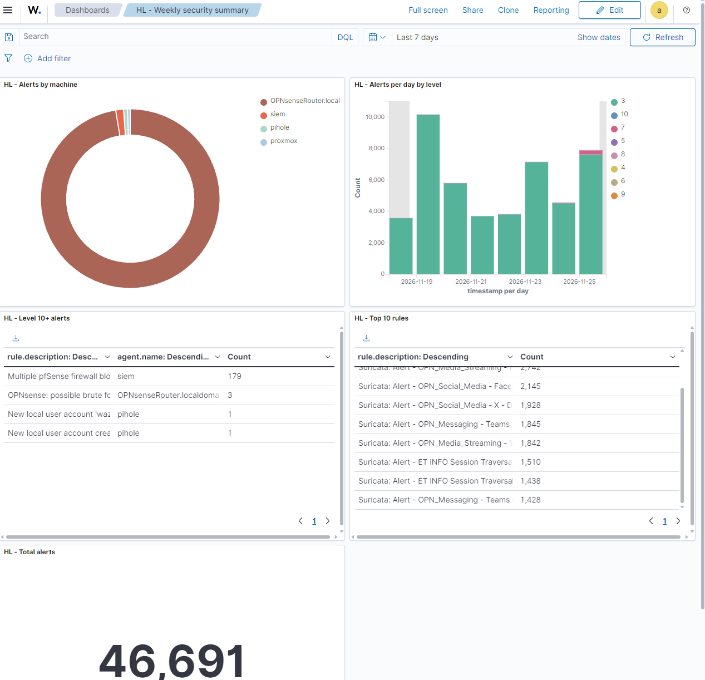

# 05 Reporting and retention

## Sizing first

Before setting retention I checked what I was storing. There were 41 daily alert indices going back to 15 October, usually 4,000 to 10,000 alerts and 5 to 10 MB a day, with two noisy days of 75,499 and 55,437 alerts. That's about 330 MB in total, so 90 days needs well under 1 GB on a disk with about 50 GB free. There were no retention policies at all.

## 90-day retention

I created an index state management (ISM) policy in **Indexer management → Dev Tools**. It keeps `wazuh-alerts-*` indices in a `hot` state and deletes them at 90 days. An `ism_template` with priority 100 applies it to new indices automatically, and I attached it to the 41 existing ones and confirmed with `_plugins/_ism/explain`.

```json
PUT _plugins/_ism/policies/wazuh-alerts-retention
{
  "policy": {
    "description": "Homelab: delete wazuh-alerts indices older than 90 days",
    "default_state": "hot",
    "states": [
      { "name": "hot", "actions": [],
        "transitions": [ { "state_name": "delete", "conditions": { "min_index_age": "90d" } } ] },
      { "name": "delete", "actions": [ { "retry": { "count": 3 }, "delete": {} } ], "transitions": [] }
    ],
    "ism_template": [ { "index_patterns": ["wazuh-alerts-*"], "priority": 100 } ]
  }
}
```

A side effect showed up later. ISM creates its own system indices with one replica, which a single-node cluster can never place, so the cluster went **yellow**. Setting replicas to 0 on those indices was refused for the `admin` user (system indices are protected), so I used the indexer's admin certificate from the server, which is the supported way in, and set the ISM history setting to 0 replicas for future indices. The cluster is green again with all 163 shards active.

## Weekly dashboard and PDF

The dashboard **HL - Weekly security summary** has five visualisations on `wazuh-alerts-*`, with "Last 7 days" saved into it:

| Panel | Type | Setup |
|---|---|---|
| HL - Total alerts | Metric | Count |
| HL - Alerts per day by level | Vertical bar | Date histogram on `timestamp` per day, split by `rule.level` |
| HL - Alerts by machine | Donut | `agent.name`, top 10 |
| HL - Top 10 rules | Data table | `rule.description`, top 10 |
| HL - Level 10+ alerts | Data table | Query `rule.level >= 10`, split by description and machine |

A report definition, **HL Weekly security summary**, turns that dashboard into a PDF every Monday at 09:00 (cron `0 9 * * 1`, Africa/Johannesburg). The report source has to be a saved dashboard or visualisation, because Wazuh's own module pages can't be used as a source.



This is the "before" picture from 25 November: 46,691 alerts in 7 days, almost all from OPNsense, a top 10 made entirely of app-detection and STUN alerts, and 179 level-10 "multiple firewall blocks" alerts from the old syslog path. All of those were tuned out that day.

## Alerts per day

From [`samples/alert-stats-by-day.csv`](../samples/alert-stats-by-day.csv):

| Day | Total | 12+ | 10 to 11 | 7 to 9 |
|---|---|---|---|---|
| 19 Nov | 10,161 | 0 | 26 | 8 |
| 22 Nov | 3,830 | 0 | 25 | 11 |
| 25 Nov | 8,332 | 0 | 21 | 439 |
| 26 Nov (to 17:08) | 3,448 | 5 | 38 | 719 |

The level 12+ alerts on 26 November were my own SSH hardening changes caught by FIM, and the jump in level 7 to 9 was package and CIS events from a day of patching and rescanning.
