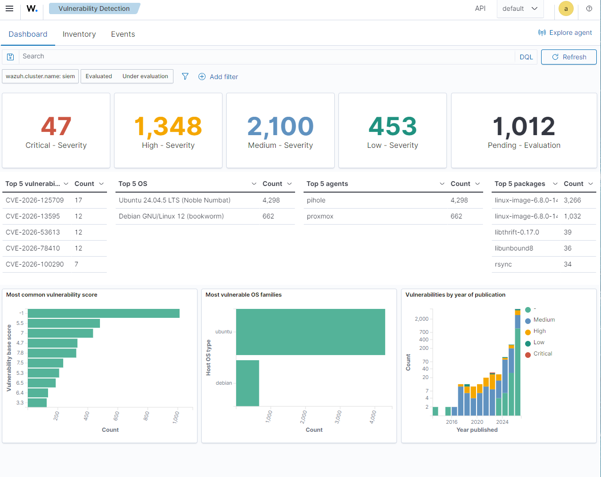
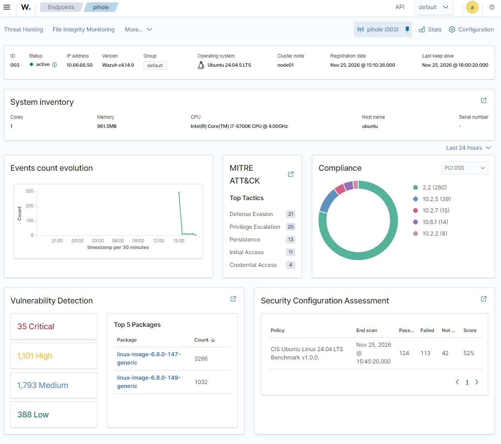
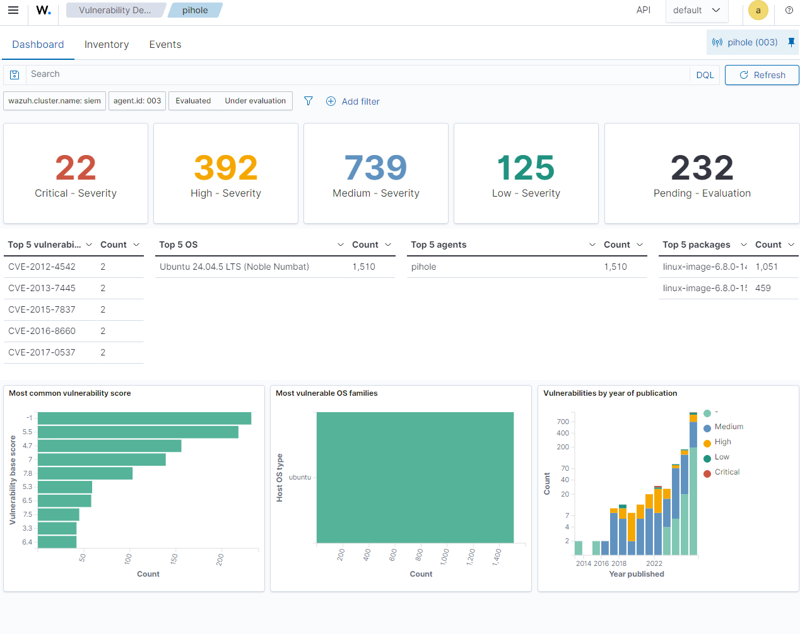
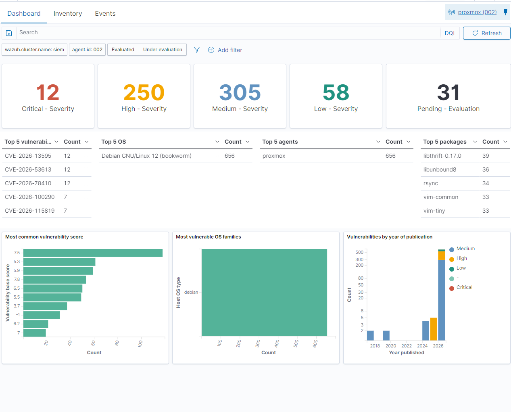

# 07 Vulnerabilities and patching

## Baseline (25 November)

Wazuh's vulnerability detection matches each agent's package inventory against its CTI feed. The first picture across all agents:

| Critical | High | Medium | Low | Pending evaluation |
|---|---|---|---|---|
| 47 | 1,348 | 2,100 | 453 | 1,012 |

The Pi-hole had 4,298 findings and Proxmox had 662. OPNsense and the SIEM server don't appear, because FreeBSD isn't covered and scanning the manager itself is off by default.

## The Pi-hole: an unbooted kernel still counts

The top two packages on the Pi-hole were **kernels**: `linux-image-6.8.0-147` with 3,266 findings and `linux-image-6.8.0-149` with 1,032.

The VM was running 6.8.0-147, while 6.8.0-149 had been installed earlier and never booted. An installed kernel is still installed software, so both counted. What I did:

1. Proxmox snapshot, then `apt full-upgrade` (27 packages, including kernel 6.8.0-151).
2. Rebooted into 6.8.0-151 (about a minute without DNS for the house).
3. `apt autoremove --purge` removed 6.8.0-147 and some unused packages (305 MB).
4. Checked Pi-hole, Unbound and the Wazuh agent were active and that the SIEM could resolve the CTI feed again.

| Pi-hole | Critical | High | Medium | Low | Total incl. pending |
|---|---|---|---|---|---|
| Before (25 Nov) | 35 | 1,101 | 1,793 | 388 | 4,298 |
| After (26 Nov) | **22** | **392** | **739** | **125** | **1,510** |

Every remaining finding was a kernel package: the 6.8.0-149 fallback (1,051) and the running 6.8.0-151 (459). I had planned to keep the fallback for a week, but 6.8.0-151 had run cleanly for about 19 hours, so I purged 6.8.0-149 the next day. That should leave about 459, most of them CVEs with no fix released yet.

## The SIEM server

The SIEM server isn't scanned by Wazuh, so I'd have missed it without checking by hand. It showed "System restart required" with 25 updates waiting, a new `libc6` and a newer kernel installed but never booted (the same problem as the Pi-hole). With the Wazuh packages held, I took a snapshot, ran `apt full-upgrade` and rebooted into 6.8.0-151, and all four services and all agents came back. It also offered an upgrade to Ubuntu 26.04, which I didn't take, because a release upgrade under Wazuh is its own project.

## Proxmox: the platform is end of life

On Proxmox, `apt` offered 13 Debian security updates (OpenSSL, CA certificates, rsync with 33 CVEs fixed, BIND tools) and **no Proxmox packages at all**. That made me check the vendor lifecycle: Proxmox VE 8 reached end of life on **31 August 2026**, together with Debian 12's regular support. Debian's security team still patches the base OS, but the hypervisor, its kernel and QEMU get no more fixes.

I installed the 13 updates (no reboot needed, because there was no kernel), disabled the Ceph enterprise repository that needed a subscription I don't have, and put the upgrade to Proxmox VE 9 on the [roadmap](roadmap.md) as its own project with fresh backups.

*Proxmox before its patch: 656 findings, led by libthrift, libunbound8 and rsync.*

Right after patching, Wazuh raised 13 level-10 alerts (rule 23505) for CVEs that still affect the *new* versions of bind9 and OpenSSL, because Debian hasn't released fixes for them yet. That's useful to know, but it also showed that vulnerability alerts at level 10 can flood Telegram, which I've noted for tuning.
