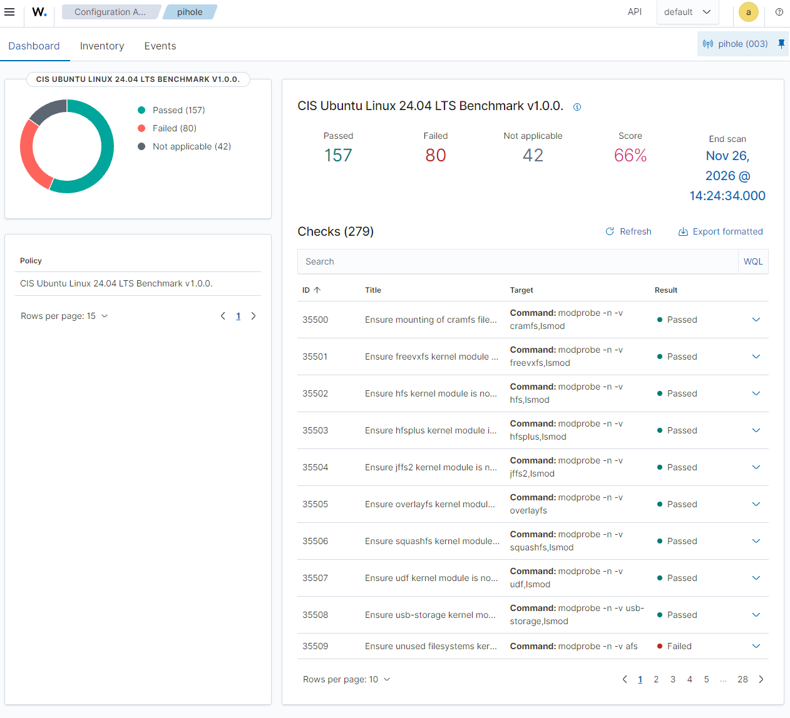
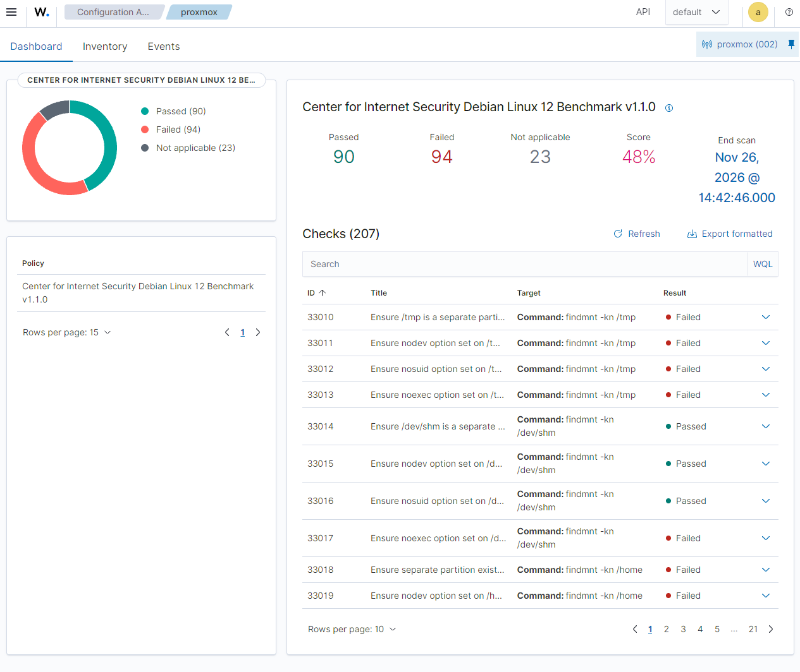

# 08 CIS hardening

Wazuh's Security Configuration Assessment (SCA) runs the CIS benchmark on each agent. My aim wasn't 100%, it was **every failed check either fixed or explained**.

| Agent | Policy | Before | After |
|---|---|---|---|
| Pi-hole | CIS Ubuntu Linux 24.04 LTS v1.0.0 | 124 passed, 113 failed, **52%** | 157 passed, 80 failed, **66%** |
| Proxmox | CIS Debian Linux 12 v1.1.0 | 77 passed, 107 failed, **41%** | 90 passed, 94 failed, **48%** |

On both machines the number of newly passed checks matched the number I targeted exactly (33 on the Pi-hole, 13 on Proxmox).

## How I worked

1. Pulled the list of failed checks from the manager's agent databases (a read-only copy, not the live file).
2. Sorted them into **safe quick wins**, **needs care** and **skip**.
3. **Read the policy's own rule for each check before fixing it**, because some checks only read one particular file. For example, the journald check needs the settings in `journald.conf` itself *and* in a drop-in file, and the root umask check needs `umask 0027` in both `.bash_profile` and `.bashrc`.
4. Took a snapshot, made the changes in small groups, checked that DNS still worked after each group, and restarted the agent to force a rescan.

## Pi-hole changes (33 checks)

All files are in [`configs/pihole/`](../configs/pihole/).

| Area | Change |
|---|---|
| Kernel network settings | No redirects sent or accepted, strict reverse-path filtering, no source routing, log martian packets, ignore IPv6 router adverts (checked first that the VM has no global IPv6 address) |
| Unused protocols | Blocked dccp, tipc, rds and sctp |
| Crash data | Core dumps off, setuid dumps off, Ubuntu's crash reporter (apport) off |
| Cron | `/etc/crontab` 600 and the cron folders 700, root only |
| Old clients | Removed telnet and ftp |
| Time and logs | Named NTP servers for timesyncd, journald size and age limits |
| Shells | Root umask 0027, idle shells closed after 15 minutes |
| SSH | Banner, `LoginGraceTime 60`, `MaxAuthTries 4`, keep-alive timeouts, `MaxStartups 10:30:60`, forwarding off, SHA-2 MACs only, `sshd_config` 600 |
| Banners | Legal warning with no OS version in `/etc/issue` and `/etc/issue.net` |

For SSH I tested with `sshd -t`, reloaded, and then proved a **new login in a second window** before closing the first. Removing telnet also removed the `ubuntu-standard` metapackage, so I checked with `apt-get -s autoremove` that nothing else was now at risk of removal.

## Proxmox changes (13 checks)

| Area | Change |
|---|---|
| SSH | Same settings as the Pi-hole plus `AllowUsers root`. **Root login stays on**, because Proxmox has no sudo and I log in as root. |
| `su` | Restricted to an empty group with `pam_wheel`. Root still works because `pam_rootok` comes first. |
| chrony | Wrote the default `user _chrony` explicitly |
| Banners | Warning in `/etc/issue.net` and an empty `/etc/motd`. I left `/etc/issue` alone, because Proxmox rewrites it at boot with the web UI address. |
| telnet | Removed, after checking `apt` wouldn't take `proxmox-ve` with it |

If SSH had broken, the Proxmox web UI shell would still have let me in.

## What I didn't fix, and why

| Group | Why |
|---|---|
| Separate partitions for `/tmp`, `/var`, `/home` and their mount options (23 checks on each machine) | They need a rebuild of the disk layout |
| Blocking unused filesystem modules (Pi-hole 35509) | The check also requires blocking `ext`, `fat` and `fuse`, and matches loosely (`ext` matches ext4), so forcing it could stop the VM booting |
| Firewall checks | They're either/or (ufw, nftables or iptables), and Proxmox uses its own firewall, which the policy doesn't recognise |
| AIDE | Wazuh FIM does this job |
| Send logs to a remote host | The Wazuh agent does this job |
| Bootloader password, auditd, password lockout and history, AppArmor enforcing | Need more care: lockout risk, or too heavy for a 1 vCPU / 1 GB Pi-hole. auditd on Proxmox is on the roadmap. |
| timesyncd on Proxmox | Proxmox uses chrony, and only one can run |

## Three bugs in Wazuh's Debian 12 policy

Reading the rules showed three Proxmox checks that can't pass, whatever the system looks like:

| Check | What the rule does | Effect |
|---|---|---|
| 33300 "accounts use shadowed passwords" | `not f:/etc/passwd -> r:^\w+:x:` | Fails exactly when accounts **are** shadowed. I confirmed every account uses `x`. |
| 33217 "root account access is controlled" | Expects the text "Password is status: P" | Debian prints `root P …`, so it can never match |
| 33048 "message of the day configured" | Pattern uses `\s` instead of `\\s` | Any motd containing a space fails, so only an empty one passes |

The lesson I took from it: trust the scan, but read the rule.
